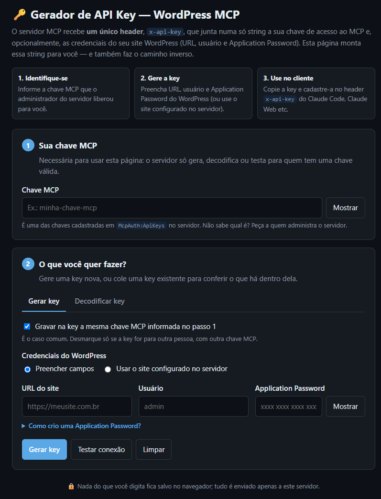

# WordPress MCP (HTTP)

Servidor [MCP](https://modelcontextprotocol.io) em .NET 10 que permite a um assistente de IA (Claude Code, Claude Web etc.) ler e gerenciar um site WordPress pela REST API, usando Application Password.

## Recursos

- Tools para posts, páginas e tipos customizados, mídia, categorias, tags, comentários, usuários, configurações, plugins e temas.
- `wp_rest_request`: chamada genérica a qualquer rota `/wp-json/...` (WooCommerce, ACF, Yoast, Abilities API...).
- Multi-site: as credenciais do WordPress vão dentro da API key (`x-api-key`); cada cliente aponta para o seu site.
- Tela para gerar/decodificar a key e testar a conexão.

## Executar

```powershell
dotnet run --project src/Backend/WordPressMcpHttp
```

- Tela de API key: http://localhost:5465/
- Endpoint MCP: http://localhost:5465/mcp
- Health: http://localhost:5465/health

Antes, cadastre ao menos uma chave MCP em `McpAuth:ApiKeys` (appsettings ou variável `McpAuth__ApiKeys__0`); lista vazia rejeita tudo (401).

## Application Password

No WordPress: *Usuários → Perfil → Senhas de aplicativo*. O site precisa de HTTPS (exceto ambiente local) e a REST API acessível. O MCP age com as permissões desse usuário.

## API Key

O header `x-api-key` carrega `[chave MCP, URL, usuário, Application Password]` embaralhados pelo `GeraApiKey` (ofuscação, não criptografia — trate como segredo). Gere pela tela, na raiz do servidor:



Ou pelos endpoints:

| Endpoint | Corpo | Resposta |
|---|---|---|
| `POST /api-key/generate` | `{mcpApiKey, wordPressUrl, wordPressUser, applicationPassword}` | `{apiKey}` |
| `POST /api-key/decode` | `{apiKey}` | campos da key |
| `POST /api-key/test-connection` | `{wordPressUrl, wordPressUser, applicationPassword}` | usuário autenticado |

Esses endpoints exigem `x-api-key` com a chave MCP em texto puro.

```powershell
claude mcp add --transport http wordpress http://localhost:5465/mcp --header "x-api-key: <key gerada>"
```

## Tools

| Tool | Descrição |
|---|---|
| `site_info`, `get_current_user` | Informações do site e do usuário das credenciais |
| `list_posts`, `get_post`, `create_post`, `update_post`, `delete_post` | Posts, páginas (`post_type="pages"`) e tipos customizados |
| `list_media`, `get_media`, `upload_media`, `update_media`, `delete_media` | Biblioteca de mídia (upload por URL ou Base64) |
| `list_categories`, `create_category`, `list_tags`, `create_tag` | Taxonomias |
| `list_comments`, `create_comment`, `update_comment`, `delete_comment` | Comentários e moderação |
| `list_users`, `get_user` | Usuários |
| `get_settings`, `update_settings`, `list_plugins`, `list_themes` | Administração (exige administrador) |
| `wp_rest_request` | Qualquer rota da REST API |

Listas retornam `{total, totalPages, items}`. `create_post` cria como rascunho; exclusões vão para a lixeira, salvo `force=true`.

## Configuração

```json
{
  "McpAuth": { "ApiKeys": [] },
  "RateLimit": { "McpPermitsPerMinute": 300, "ApiKeyPermitsPerMinute": 10 },
  "WordPress": { "Url": "", "User": "", "ApplicationPassword": "", "TimeoutSeconds": 60 }
}
```

A seção `WordPress` (ou `WORDPRESS_URL`, `WORDPRESS_USER`, `WORDPRESS_APP_PASSWORD`) é o site padrão, usado quando a key não traz credenciais.
